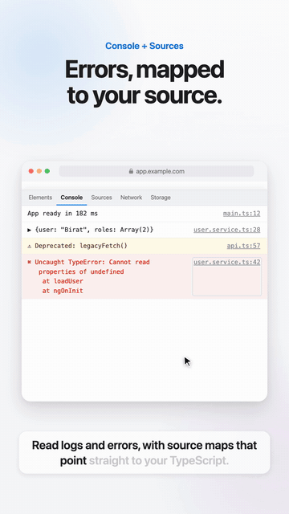

# Safari DevTools

**The best in-page DevTools for Safari and iPhone.** It's a Chrome-style debugging panel that lives right inside the page. It works in Safari on Mac, iPhone and iPad, including in-app WebViews, with no cable, Xcode or Mac pairing. It also gives your tests and AI agents the same view of the page through Playwright, WebDriver, an HTTP API and MCP.

<p align="center">
  
  
  
  
</p>

<p align="center">
  <a href="docs/safari-devtools-demo.mp4"></a>
  <br>
  <b><a href="docs/safari-devtools-demo.mp4">▶ Watch the 40-second demo (with sound)</a></b>
</p>

It's one dependency-free JavaScript file, plus an optional Safari extension that adds it to every website.

## Before vs after

| You want to… | Before: Safari on its own | Now: with Safari DevTools |
|---|---|---|
| See console errors on an iPhone | Plug the phone into a Mac, enable Web Inspector on both, open Develop → device → page | Press **Ctrl+Shift+D** on the page, or stream it to your Mac over Wi-Fi |
| Debug a page inside an app's WebView | Only possible if the app marks its WebView inspectable | Works anywhere you can load one script |
| Find where a minified error came from | Open Sources and step through the source map | The Console shows `UserService.loadUser (user.service.ts:42)`, and the link opens that line |
| Test what happens when an API fails or is slow | Set up local overrides or a proxy | Right-click the request → **Mock**, **Block** or **Delay**, or pick **Slow 3G / Offline** |
| Turn CSS tweaks back into source code | Retype each change into your `.scss` | **Changes** tab → **Copy as CSS** (it keeps `@media` blocks) |
| Check a web component's API | Dig through the shadow DOM by hand | **Component** pane: properties, slots, `::part()` hooks and the CSS variables it reads |
| Compare the page with the Figma design | Take screenshots and flip between them | **Design overlay** with opacity and difference blend, plus **⌥+hover** to measure |
| Catch iPhone-only layout bugs | Find them on a real device, one at a time | **Audit** flags inputs that cause zoom, `100vh`, broken sticky, safe-area misses, sideways scroll and more |
| Let tests or AI agents read the page | Not available | `SafariDevTools.automation` JSON API, a Playwright fixture, WebDriver, an HTTP API and an **MCP server** |

## How it compares

| | **Safari DevTools** | Safari Web Inspector | Eruda / vConsole |
|---|:---:|:---:|:---:|
| Runs on iPhone with no Mac or cable | ✅ | ❌ | ✅ |
| Works in third-party app WebViews | ✅ | Only if inspectable | ✅ |
| Console with source-mapped stack traces | ✅ | ✅ | ❌ |
| Elements, styles and shadow DOM | ✅ | ✅ | Partial |
| Web-component inspector (props, slots, parts, CSS vars) | ✅ | Partial | ❌ |
| Live CSS with design-token autocomplete | ✅ | Partial | ❌ |
| CSS changes as a copyable diff | ✅ | ✅ | ❌ |
| Grid and flex overlays | ✅ | ✅ | ❌ |
| Figma-style measure tool and design overlay | ✅ | ❌ | ❌ |
| Design-token editor (all `--variables`) | ✅ | ❌ | ❌ |
| Mock, block or delay requests | ✅ | ✅ | ❌ |
| WebSocket and EventSource messages | ✅ | ✅ | ❌ |
| Safari/iPhone pitfalls and accessibility audit (through shadow DOM) | ✅ | Partial | ❌ |
| Fonts, images and animations inspectors | ✅ | Partial | ❌ |
| Remote debugging over Wi-Fi from any browser | ✅ | Pairing required | ❌ |
| Playwright fixture, JSON API and MCP server for AI agents | ✅ | ❌ | ❌ |
| Step-through JavaScript debugger | ❌ | ✅ | ❌ |
| HttpOnly cookies and browser-level request headers | ❌ | ✅ | ❌ |

Safari DevTools runs inside the page, which is what makes it work on any device and in any WebView. For step-through debugging and browser-internal data, keep Safari's Web Inspector alongside it: the two complement each other. (Comparison as of October 2026. Built-in tools change, so corrections are welcome.)

## What's new

| Version | Highlights |
|---|---|
| **1.2** | **Changes** tab (CSS diff → copy as CSS or patch), **grid and flex overlays**, **⌥+hover measure tool**, **design overlay** with difference blend, and the **Assets** tab (rendered fonts and fallbacks, oversized or blurry images, an animation slow-motion and scrubber) |
| **1.1** | Automation API, Playwright fixture (WebKit desktop and iPhone), WebDriver script for real Safari, relay HTTP API and **MCP server** for AI agents |
| **1.0** | Console, Elements (Styles, Computed, Listeners, Component), Sources with source maps, Network with mocking and throttling, Storage, Performance, Tokens, Audit, Device, remote mode for iPhone, and the Safari extension |

## Screenshots

<table>
  <tr>
    <td align="center"><br><b>Console</b><br>Errors link to the original file</td>
    <td align="center"><br><b>Sources</b><br>Source maps open the exact line</td>
    <td align="center"><br><b>Styles</b><br>Suggestions for <code>var(--tokens)</code></td>
  </tr>
  <tr>
    <td align="center"><br><b>Live CSS</b><br>Edits apply instantly</td>
    <td align="center"><br><b>Network</b><br>Requests with a waterfall</td>
    <td align="center"><br><b>Storage</b><br>Edit local storage and cookies</td>
  </tr>
</table>

## Features

| Panel | Highlights |
|---|---|
| **Console** | Logs, errors and rejections. Source-mapped stack traces show original names, like `UserService.loadUser (user.service.ts:42)`. The REPL has autocomplete, history, `$0`, `$()`, `$$()` and `copy()`. |
| **Elements** | DOM tree including shadow roots, a picker, and find by text, selector or XPath. Copy a node's selector, JS path, XPath or HTML. DOM breakpoints log the call stack. |
| **Styles · Listeners · Component** | Live CSS with token autocomplete, plus inherited, `:host` and user-agent rules. See every event listener and where it was added. For web components: properties, slots, `::part()` and the CSS variables they read, with Lit and Angular details. |
| **Sources** | Original files from source maps, with search across all files. |
| **Network** | fetch, XHR, WebSocket and SSE. **Mock, block or delay** requests, throttle to 3G or offline, copy as fetch or cURL, replay requests, and export a HAR file. |
| **Storage** | Local storage, session storage and cookies, with editing. |
| **Changes** | Every CSS edit you made in the panel as a before/after diff, with copy as CSS (for `.scss`) or as a diff, and revert. |
| **Assets** | Fonts that actually rendered (and fallbacks), oversized or blurry images, and animations you can pause, scrub and slow down. |
| **Performance** | Web Vitals where Safari supports them, live FPS and DOM-size graphs, long tasks and a memory-leak check. |
| **Tokens** | Every `--css-variable` on the page, grouped, with live overrides you can copy as CSS. |
| **Audit** | Safari and iPhone pitfalls, plus accessibility checks that reach into shadow DOM. |
| **Device** | A design overlay that compares the page with a Figma export (opacity, scale, difference blend), plus the safe-area and viewport overlay, a touch visualiser and outline-all-elements. |
| **Layout and measuring** | Grid and flex overlays (lines, numbers, gaps, direction), and ⌥+hover distance measuring as in Figma. |
| **Remote mode** | Debug an iPhone from your Mac over Wi-Fi: `node standalone/remote/relay.js`. |
| **Automation** | `SafariDevTools.automation` JSON API, a Playwright fixture (WebKit desktop and iPhone), WebDriver for real Safari, and an HTTP API plus an **MCP server** for AI agents. See [standalone/README.md](standalone/README.md#automation-playwright-real-safari-and-ai-agents). |

Extras: light and dark themes, docking to the bottom or right, a debug-report export, and settings remembered per site.

Shortcuts: **Ctrl+Shift+D** shows or hides the panel, and **Ctrl+Shift+C** picks an element.

## Use it

### Option 1: Safari extension (works on every site)

1. Download this repo: green **Code** button → **Download ZIP**, then unzip it.
2. Safari → Settings → Advanced → tick **Show features for web developers**.
3. Safari → Settings → **Developer** → **Add Temporary Extension…** → select the **`extension`** folder.
4. Settings → **Extensions** → tick **Safari DevTools**, then **Edit Websites…** → **Allow**.
5. Reload any page and press **Ctrl+Shift+D**, or click the `</>` toolbar icon.

Temporary extensions are removed when Safari quits. To install it permanently, build it with Xcode; see [`extension/README.md`](extension/README.md).

### Option 2: Script tag (your own app)

Add this as the first thing in `<head>`, in development builds only:

```html
<script src="https://cdn.jsdelivr.net/gh/biratdatta/safari-devtools@main/standalone/safari-devtools.js"></script>
```

### Option 3: Try the demo

Open [`standalone/demo.html`](standalone/demo.html) in Safari.

## Repo layout

```
standalone/   safari-devtools.js (the tool), demo.html, docs, remote/ (relay + viewer for iPhone debugging)
extension/    Safari Web Extension (manifest, content script, icons, Xcode build script)
docs/         demo video, GIF and screenshots used in this README
sync.sh       copies standalone/safari-devtools.js into extension/
```

`safari-devtools.js` is the same file in both folders. Edit the one in `standalone/`, then run `./sync.sh`.

## Limits

These come from running inside the page instead of inside the browser:

- HttpOnly cookies, browser-added request headers and cross-origin stylesheets aren't visible.
- There's no step-through JavaScript debugger. DOM breakpoints log a stack trace instead and can trigger Web Inspector's debugger.
- Sites with a strict Content-Security-Policy may block the injected script.

## License

MIT. See [LICENSE](LICENSE).
