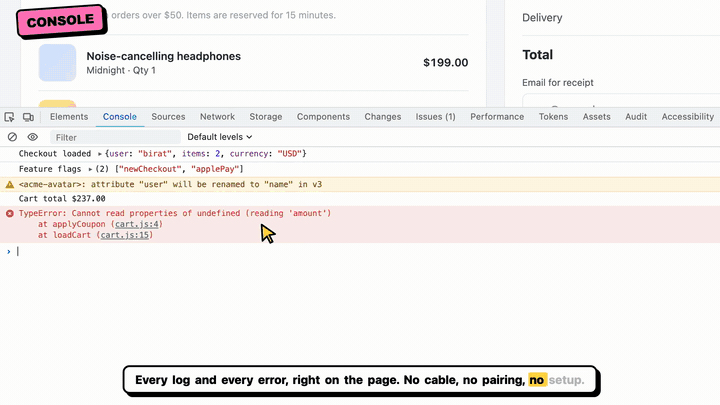
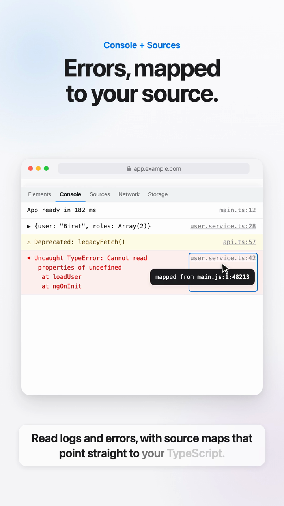
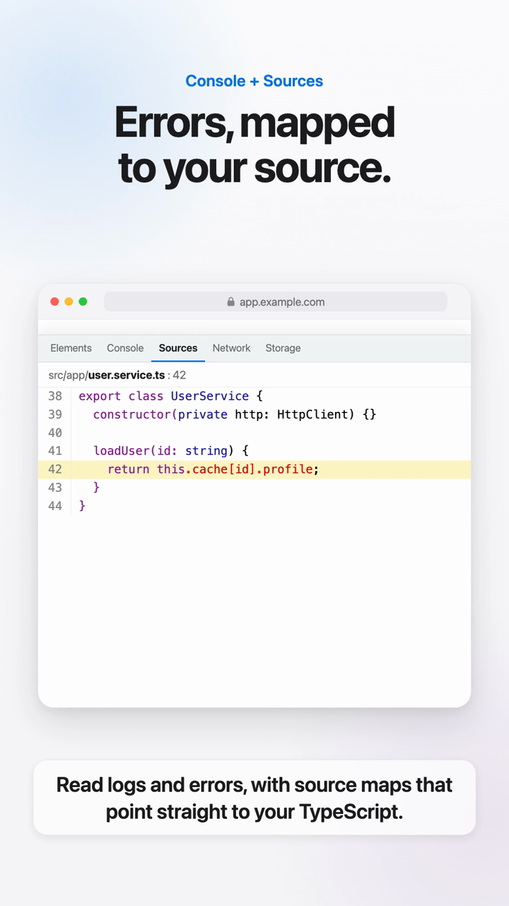
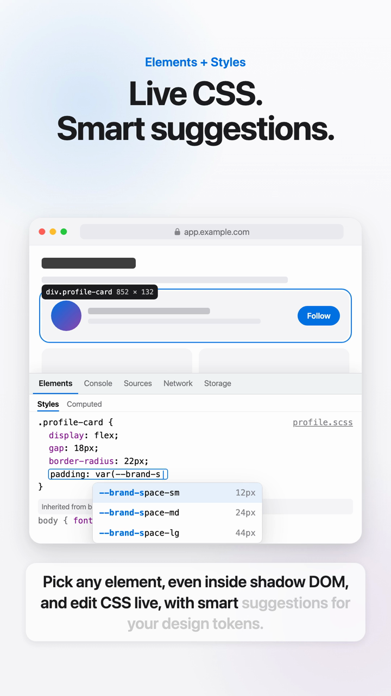
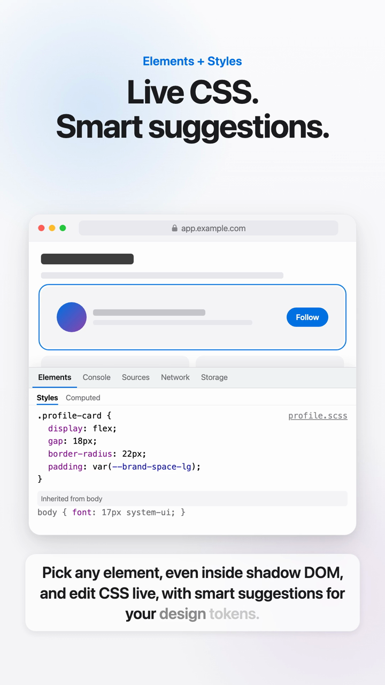
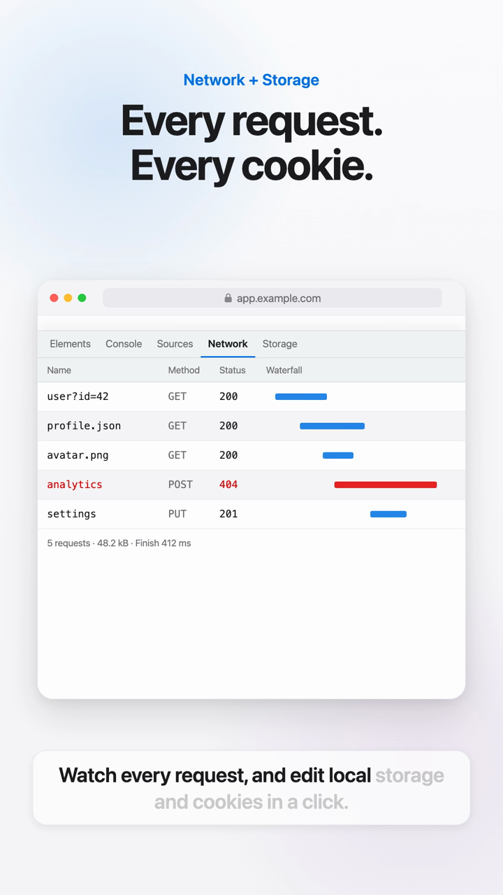
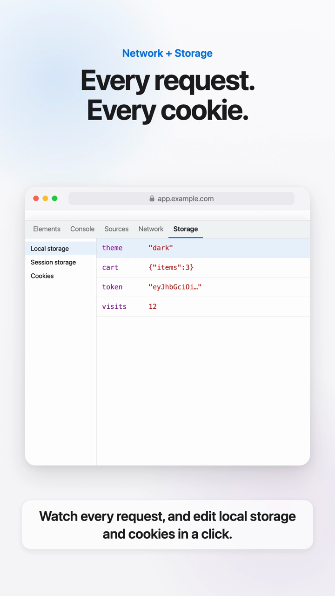

# Safari DevTools

**The best in-page DevTools for Safari and iPhone, and it works in Chrome too.** It's a Chrome-style debugging panel that lives right inside the page. It works in Safari on Mac, iPhone and iPad, including in-app WebViews, with no cable, Xcode or Mac pairing, and in Chrome, Edge and other Chromium browsers on desktop and Android, with an extension for each. It also gives your tests and AI agents the same view of the page through Playwright, WebDriver, an HTTP API and MCP.

<p align="center">
  
  
  
  
</p>

<p align="center">
  <a href="docs/safari-devtools-1.5-demo.mp4"></a>
  <br>
  <b><a href="docs/safari-devtools-1.5-demo.mp4">▶ Watch the 1-minute demo (with sound)</a></b> · <a href="docs/safari-devtools-1.5-demo-vertical.mp4">vertical version for phones</a>
</p>

**Website:** [devtools.biratdatta.tech](https://devtools.biratdatta.tech) · [简体中文](https://devtools.biratdatta.tech/zh/) · [日本語](https://devtools.biratdatta.tech/ja/)

It's one dependency-free JavaScript file, plus an optional Safari extension that adds it to every website.

## Before vs after

| You want to… | Before: Safari on its own | Now: with Safari DevTools |
|---|---|---|
| See console errors on an iPhone | Plug the phone into a Mac, enable Web Inspector on both, open Develop → device → page | Press **Ctrl+Shift+D** on the page, or stream it to your Mac over Wi-Fi |
| Debug a page inside an app's WebView | Only possible if the app marks its WebView inspectable | Works anywhere you can load one script |
| Find where a minified error came from | Open Sources and step through the source map | The Console shows `UserService.loadUser (user.service.ts:42)`, and the link opens that line |
| Test what happens when an API fails or is slow | Set up local overrides or a proxy | Right-click the request → **Mock**, **Block** or **Delay**, or pick **Slow 3G / Offline** |
| Turn CSS tweaks back into source code | Retype each change into your `.scss` | **Changes** tab → **Copy as CSS** (it keeps `@media` blocks) |
| Check a web component's API | Dig through the shadow DOM by hand | **Component** pane: properties, slots, `::part()` hooks and the CSS variables it reads |
| Compare the page with the Figma design | Take screenshots and flip between them | **Design overlay** with opacity and difference blend, plus **⌥+hover** to measure |
| Catch iPhone-only layout bugs | Find them on a real device, one at a time | **Audit** flags inputs that cause zoom, `100vh`, broken sticky, safe-area misses, sideways scroll and more |
| Time-travel through Redux / NgRx state in Safari | Not possible: Safari has no Redux DevTools extension | **Components → Store**: action log, diff, Jump and Dispatch |
| Understand an unfamiliar error | Copy the stack, find the source, paste both into a chat | **✨ Explain** on the error sends the original source, recent requests and logs to Claude |
| File a good bug report | Screenshot, retype steps, export a HAR, copy the console | 🐞 **Report a bug**: steps, errors, HAR, device info and screenshot, filed in Jira in one click |
| See what VoiceOver gets | Turn on VoiceOver and listen | **Accessibility** tab: role, name and state for every element (through shadow DOM), tab order overlay, focus tracker |
| Fix low contrast | Guess a darker colour, re-check | **Contrast**: nearest passing colour from your design tokens, one click to apply |
| Catch unintended CSS changes in a component | Compare screenshots by eye | **Snapshots**: save a baseline, then see every style, size, position and text change |
| Test dark mode, RTL, big text and long translations | Change system settings or the code | **Emulation** toggles, including pseudo-localisation, plus a side-by-side iPhone/iPad **responsive preview** |
| Let tests or AI agents read the page | Not available | `SafariDevTools.automation` JSON API, a Playwright fixture, WebDriver, an HTTP API and an **MCP server** |

## How it compares

| | **Safari DevTools** | Safari Web Inspector | Eruda / vConsole |
|---|:---:|:---:|:---:|
| Same panel in Safari and Chrome (extension for both) | ✅ | Safari only | ✅ |
| Runs on iPhone with no Mac or cable | ✅ | ❌ | ✅ |
| Works in third-party app WebViews | ✅ | Only if inspectable | ✅ |
| Console with source-mapped stack traces | ✅ | ✅ | ❌ |
| Elements, styles and shadow DOM | ✅ | ✅ | Partial |
| Web-component inspector (props, slots, parts, CSS vars) | ✅ | Partial | ❌ |
| Live CSS with design-token autocomplete | ✅ | Partial | ❌ |
| CSS changes as a copyable diff | ✅ | ✅ | ❌ |
| Grid and flex overlays | ✅ | ✅ | ❌ |
| Figma-style measure tool and design overlay | ✅ | ❌ | ❌ |
| Design-token editor (all `--variables`) | ✅ | ❌ | ❌ |
| Mock, block or delay requests | ✅ | ✅ | ❌ |
| WebSocket and EventSource messages | ✅ | ✅ | ❌ |
| Safari/iPhone pitfalls and accessibility audit (through shadow DOM) | ✅ | Partial | ❌ |
| Fonts, images and animations inspectors | ✅ | Partial | ❌ |
| Angular, Lit and React component inspector | ✅ | ❌ | ❌ |
| Redux / NgRx store log with time travel | ✅ | ❌ | ❌ |
| Live expressions, snippets and command palette | ✅ | Partial | Partial |
| "Explain this error" with Claude (source + requests as context) | ✅ | ❌ | ❌ |
| One-click Jira bug report (steps, HAR, errors, screenshot) | ✅ | ❌ | ❌ |
| Accessibility tree through shadow DOM, tab-order overlay, focus tracker | ✅ | Partial | ❌ |
| Contrast fixer using your design tokens | ✅ | ❌ | ❌ |
| Visual regression snapshots of components | ✅ | ❌ | ❌ |
| CSS coverage and unused design tokens | ✅ | ❌ | ❌ |
| Emulate dark mode, reduced motion, RTL, text size, pseudo-localisation | ✅ | Partial | ❌ |
| Side-by-side iPhone/iPad responsive preview | ✅ | Partial | ❌ |
| Remote debugging over Wi-Fi from any browser | ✅ | Pairing required | ❌ |
| Playwright fixture, JSON API and MCP server for AI agents | ✅ | ❌ | ❌ |
| Step-through JavaScript debugger | ❌ | ✅ | ❌ |
| HttpOnly cookies and browser-level request headers | ❌ | ✅ | ❌ |

Safari DevTools runs inside the page, which is what makes it work on any device and in any WebView. For step-through debugging and browser-internal data, keep Safari's Web Inspector alongside it: the two complement each other. (Comparison as of October 2026. Built-in tools change, so corrections are welcome.)

## What's new

| Version | Highlights |
|---|---|
| **1.5** | **Chrome DevTools look**: Chrome's current light and dark colours, tab bar with a » overflow menu and a device-toolbar button, error and warning icons, a "Default levels" menu and live-expression eye in the Console, `== $0` on the selected element, Chrome-style Network table. Fixes: works on sites that swap their document at load, opens inside full-window frames (claude.ai artifacts, CodePen, Storybook), never breaks a page's own `addEventListener`, Trusted Types support, and sign-in codes and tokens are blanked in bug reports. |
| **1.4** | Works in **Chrome, Edge and other Chromium browsers** (new Chrome extension, Chromium Playwright projects), **✨ Explain this error** with Claude, one-click **Jira bug reports** (auto steps, HAR, screenshot), **Accessibility** tab (tree through shadow DOM, tab-order overlay, focus tracker, contrast fixer with design tokens), visual-regression **Snapshots**, CSS **Coverage**, **emulation** (dark/light, reduced motion, RTL, text size, pseudo-localisation, colour blindness) and a side-by-side **responsive preview** |
| **1.3** | **Components** tab (Angular signals, Lit and React trees, and a Redux/NgRx store with time travel), **Issues** tab, **live expressions**, **preserve log**, Chrome's console helpers, real `console.table`, **Snippets** and a **command palette** |
| **1.2** | **Changes** tab (CSS diff → copy as CSS or patch), **grid and flex overlays**, **⌥+hover measure tool**, **design overlay** with difference blend, and the **Assets** tab (rendered fonts and fallbacks, oversized or blurry images, an animation slow-motion and scrubber) |
| **1.1** | Automation API, Playwright fixture (WebKit desktop and iPhone), WebDriver script for real Safari, relay HTTP API and **MCP server** for AI agents |
| **1.0** | Console, Elements (Styles, Computed, Listeners, Component), Sources with source maps, Network with mocking and throttling, Storage, Performance, Tokens, Audit, Device, remote mode for iPhone, and the Safari extension |

## Screenshots

<table>
  <tr>
    <td align="center"><br><b>Console</b><br>Errors link to the original file</td>
    <td align="center"><br><b>Sources</b><br>Source maps open the exact line</td>
    <td align="center"><br><b>Styles</b><br>Suggestions for <code>var(--tokens)</code></td>
  </tr>
  <tr>
    <td align="center"><br><b>Live CSS</b><br>Edits apply instantly</td>
    <td align="center"><br><b>Network</b><br>Requests with a waterfall</td>
    <td align="center"><br><b>Storage</b><br>Edit local storage and cookies</td>
  </tr>
</table>

## Features

| Panel | Highlights |
|---|---|
| **Console** | Logs, errors and rejections. Source-mapped stack traces show original names, like `UserService.loadUser (user.service.ts:42)`. The REPL has autocomplete, history, `$0`, `$()`, `$$()` and `copy()`. |
| **Elements** | DOM tree including shadow roots, a picker, and find by text, selector or XPath. Copy a node's selector, JS path, XPath or HTML. DOM breakpoints log the call stack. |
| **Styles · Listeners · Component** | Live CSS with token autocomplete, plus inherited, `:host` and user-agent rules. See every event listener and where it was added. For web components: properties, slots, `::part()` and the CSS variables they read, with Lit and Angular details. |
| **Sources** | Original files from source maps, with search across all files. |
| **Network** | fetch, XHR, WebSocket and SSE. **Mock, block or delay** requests, throttle to 3G or offline, copy as fetch or cURL, replay requests, and export a HAR file. |
| **Storage** | Local storage, session storage and cookies, with editing. |
| **Components** | Angular (signals and inputs), Lit and React component trees with editable state, plus a **Redux/NgRx/Zustand store log with time travel**. Safari has no Redux DevTools, so this provides it. |
| **Issues** | CSP violations, mixed content, deprecated APIs, scroll-blocking listeners, and failed loads and requests, in one place. |
| **Console power-ups** | Live expressions, preserving the log across reloads, real `console.table`, `monitorEvents`, `monitor`, `debug`, `getEventListeners`, Snippets per site, and a **⌘K / Ctrl+Shift+P command palette**. |
| **Changes** | Every CSS edit you made in the panel as a before/after diff, with copy as CSS (for `.scss`) or as a diff, and revert. |
| **Assets** | Fonts that actually rendered (and fallbacks), oversized or blurry images, and animations you can pause, scrub and slow down. |
| **Explain & report** | **✨ Explain** on any error asks Claude for the cause and a fix, using the original source, recent requests and logs. 🐞 **Report a bug** files a Jira issue with auto-captured steps, errors, HAR, device info and a screenshot. |
| **Accessibility** | Accessibility tree (role, name, states) through shadow DOM, a numbered **tab-order overlay**, a **focus tracker** that flags focus escaping dialogs or getting lost, and a **contrast fixer** that suggests the nearest passing colour from your tokens. |
| **Snapshots · Coverage** | Save a component as a baseline and get every style, layout and text difference after a change. Find CSS rules and design tokens that nothing on the page uses. |
| **Performance** | Web Vitals where Safari supports them, live FPS and DOM-size graphs, long tasks and a memory-leak check. |
| **Tokens** | Every `--css-variable` on the page, grouped, with live overrides you can copy as CSS. |
| **Audit** | Safari and iPhone pitfalls, plus accessibility checks that reach into shadow DOM. |
| **Device** | **Emulation** (dark/light, reduced motion, RTL, text size, pseudo-localisation, colour-vision filters), a side-by-side **iPhone/iPad responsive preview**, a design overlay that compares the page with a Figma export (opacity, scale, difference blend), plus the safe-area and viewport overlay, a touch visualiser and outline-all-elements. |
| **Layout and measuring** | Grid and flex overlays (lines, numbers, gaps, direction), and ⌥+hover distance measuring as in Figma. |
| **Remote mode** | Debug an iPhone from your Mac over Wi-Fi: `node standalone/remote/relay.js`. |
| **Automation** | `SafariDevTools.automation` JSON API, a Playwright fixture (WebKit desktop and iPhone), WebDriver for real Safari, and an HTTP API plus an **MCP server** for AI agents. See [standalone/README.md](standalone/README.md#automation-playwright-real-safari-and-ai-agents). |

Extras: light and dark themes, docking to the bottom or right, a debug-report export, and settings remembered per site.

Shortcuts: **Ctrl+Shift+D** shows or hides the panel, and **Ctrl+Shift+C** picks an element.

## Use it

### Option 1a: Safari extension (works on every site)

1. Download this repo: green **Code** button → **Download ZIP**, then unzip it.
2. Safari → Settings → Advanced → tick **Show features for web developers**.
3. Safari → Settings → **Developer** → **Add Temporary Extension…** → select the **`extension`** folder.
4. Settings → **Extensions** → tick **Safari DevTools**, then **Edit Websites…** → **Allow**.
5. Reload any page and press **Ctrl+Shift+D**, or click the `</>` toolbar icon.

Temporary extensions are removed when Safari quits. To install it permanently, build it with Xcode; see [`extension/README.md`](extension/README.md).

### Option 1b: Chrome extension (Chrome, Edge, Brave, Arc, Opera)

1. Download this repo and unzip it, as above.
2. Open `chrome://extensions` (or `edge://extensions`) and switch on **Developer mode** (top right).
3. Click **Load unpacked** and select the **`chrome-extension`** folder.
4. Pin it from the puzzle-piece menu. Reload any page and press **Alt+Shift+D** (or click the icon).

In Chrome the tool loads as a "main world" content script before the page's own code, so it also works on sites whose Content-Security-Policy blocks injected scripts. Change the shortcut at `chrome://extensions/shortcuts`. Needs Chrome 111 or later.

### Option 1c: Bookmarklet (any browser, no install)

If an extension isn't allowed on a site (for example a work Chrome policy), use the bookmarklet in [`standalone/bookmarklet.md`](standalone/bookmarklet.md). It loads the panel into the current page with one click.

### Option 2: Script tag (your own app)

Add this as the first thing in `<head>`, in development builds only:

```html
<script src="https://cdn.jsdelivr.net/gh/biratdatta/safari-devtools@main/standalone/safari-devtools.js"></script>
```

### Option 3: Try the demo

Open [`standalone/demo.html`](standalone/demo.html) in Safari or Chrome.

## Repo layout

```
standalone/   safari-devtools.js (the tool), demo.html, docs, remote/ (relay + viewer for iPhone debugging)
extension/          Safari Web Extension (manifest, content script, icons, Xcode build script)
chrome-extension/   Chrome / Edge extension (Manifest V3, service worker, MAIN-world content script)
docs/               demo videos (16:9 and 9:16), GIF and screenshots used in this README
site/               the website (static, deployed by Cloudflare Pages from this folder)
sync.sh             copies safari-devtools.js into both extensions and the website, and rebuilds the download zips
```

`safari-devtools.js` is the same file in all three folders, and `content.js` / `background.js` are shared by both extensions. Edit `standalone/safari-devtools.js` (or `extension/`'s shared files), then run `./sync.sh`.

## Limits

These come from running inside the page instead of inside the browser:

- HttpOnly cookies, browser-added request headers and cross-origin stylesheets aren't visible.
- There's no step-through JavaScript debugger. DOM breakpoints log a stack trace instead and can trigger the browser's own debugger (Web Inspector or Chrome DevTools).
- Sites with a strict Content-Security-Policy may block the injected script.

## License

MIT. See [LICENSE](LICENSE).
